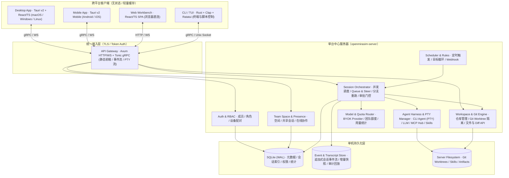
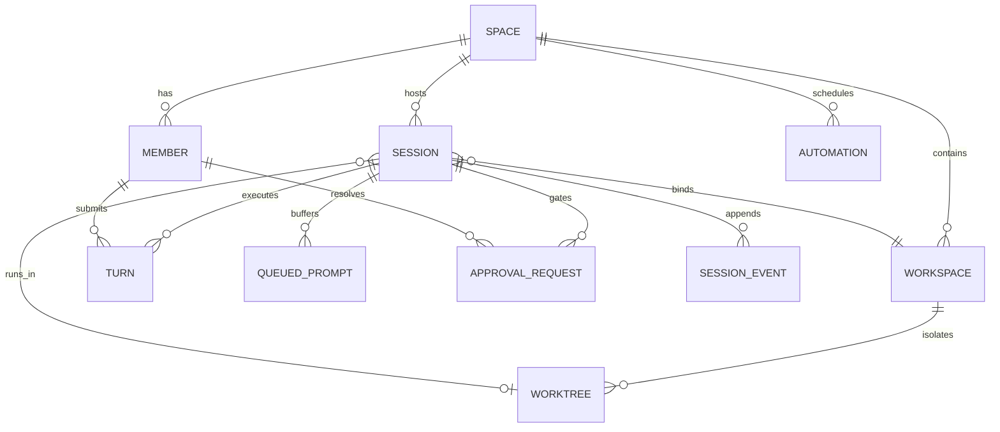

# OpenMirasim 系统架构设计

本文档定义 OpenMirasim 的总体架构、核心领域模型、通信协议、存储与安全边界以及 Monorepo 结构规划。项目定位为**以单台服务器为中心的团队协作式 C/S 架构跨平台 AI Agent 工作台**，借鉴 Mirasim 的多 Agent 并发编排、多端无缝接续与脚本化控制体验，并面向开源自托管团队场景进行重构。

---

## 1. 设计目标与架构原则

1. **Single-Server-Centric（单机中心化）**
   - 所有长期运行的状态（Agent 会话、PTY 进程、Git Worktree、文件变更、事件流、团队聊天与定时任务）全部驻留在中心服务器。
   - 任意客户端关闭、休眠或切网都不会中断 Agent 执行；任意端重新连接即可从事件流恢复完整上下文（Zero Context Loss）。
2. **Team-First Multiplayer（原生团队协作）**
   - 以 **Team Space** 为协作边界，支持多成员共享工作区、实时观察同一会话输出、向运行中的会话排队/插队指令（Queue & Steer）以及协同审批高危操作。
3. **Thin & Consistent Clients（轻量一致的多端形态）**
   - 桌面端（Tauri v2）、Web 工作台、移动端（Tauri v2 Mobile）共享同一套 React/TypeScript UI 与状态同步协议；CLI/TUI 通过同一服务端 API 提供完整自动化与运维能力。
4. **Protocol-First（协议先行）**
   - 使用 Protobuf + Buf 定义控制面与事件流契约，为 Rust 服务端、Tauri Core、CLI 与 TypeScript 前端生成强类型接口。
5. **Harness & Model Agnostic（Agent 与模型无关）**
   - 通过统一的 Harness 适配层兼容外部 CLI Agent（如 Claude Code、Codex、OpenCode 等）与原生 LLM API Agent，支持团队统一路由或个人 BYOK 凭证隔离。

---

## 2. 总体 C/S 拓扑



---

## 3. 核心领域模型



- **Space（团队空间）**：租户与协作边界，包含成员列表、共享工作区、全局 Skills/MCP 配置、默认模型策略与团队公告/聊天频道。
- **Workspace（工作区）**：服务端本地注册的代码仓库或目录，对外暴露受控文件浏览、搜索与 Git 状态/Diff 接口。
- **Worktree（隔离分支工作树）**：每个并行 Agent 会话可绑定独立 Git Worktree，避免多个 Agent 并发修改同一目录导致冲突，支持分支对比与一键合并/清理。
- **Session（会话）**：一次持续演进的 Agent 任务线程，包含绑定的 Harness/模型配置、所属工作区、父子分支关系（支持从任意历史 Turn 分叉重跑）以及关联的 PTY 实例。
- **Queue & Steer（指令队列与实时转向）**：成员在 Agent 运行中可追加待执行指令（Queue），也可执行插队（Jump）、撤回（Recall）或将消息即时注入当前 Turn（Steer）。
- **Approval Request（审批请求）**：当 Agent 请求执行高危命令、越界写文件或调用受限 MCP 工具时，服务端挂起该步骤并向在线成员（含手机端）广播审批卡片，支持原子化抢占审批与审计留痕。
- **Event Stream（统一事件流）**：每个会话拥有单调递增序号（`seq`）的事件流（消息分片、工具调用、PTY 帧、状态变更、审批结果），客户端断线重连只需携带 `last_seq` 即可增量追平。

---

## 4. 服务端核心子系统

### 4.1 接入与传输层（`openmirasim-server`）
- 单进程监听统一端口（默认 HTTPS/HTTP + WebSocket，并支持 gRPC 复用或独立监听端口，本地 CLI 亦支持 Unix Domain Socket）。
- 同时托管编译后的前端 Web 工作台静态资源，部署单二进制即可开箱使用。

### 4.2 会话编排引擎（Session Orchestrator）
- 每个活跃会话由独立的 Tokio Actor 管理，串行化状态机转换（`Idle -> Running -> WaitingApproval -> Settled / Failed / Cancelled`），避免并发竞态。
- 支持 **Session Messaging**：允许协调者 Agent（或成员）向子会话派发任务、读取摘要、汇总多路并行结果。

### 4.3 Agent Harness 与 PTY 运行时
- **PTY Runtime**：基于 Rust 异步 PTY 管理真实终端会话（如 `claude`、`codex`、`bash`），支持窗口大小调整（Resize）、ANSI 环形缓冲区回放以及聊天视图与原生 TUI 视图双模式切换。
- **MCP Hub & Skills Registry**：在 Space 与 Workspace 两级统一管理 MCP Server 生命周期、健康检查与 Skill 分发。
- **Model & Account Router**：支持统一配置上游 Provider（Anthropic / OpenAI / Gemini / OpenAI-Compatible / 本地 Ollama 等），按团队或个人绑定配额，并记录不含敏感内容的调用耗时与 Token 统计。

### 4.4 存储与容错
- **SQLite（WAL 模式）**：单文件零外部数据库依赖，配合连接池与受控写串行队列满足中小团队单机高并发读写。
- **Event / Transcript Log**：采用按会话分段的追加式日志或 WAL 表结构保存高吞吐流式事件，支持全文检索（SQLite FTS5）与会话导出。
- **进程恢复**：服务端重启时自动检测孤立会话并标记为可恢复状态，支持按 Harness 原生 Session ID 执行 `resume`。

---

## 5. 客户端架构

### 5.1 共享 Web UI（React + TypeScript）
- 单一前端代码库同时编译为：
  1. 中心服务器内嵌的 **Web Workbench**；
  2. **Tauri v2 Desktop** 渲染层（多窗格分屏、命令面板、Diff 查看器、xterm.js 终端面板）；
  3. **Tauri v2 Mobile** 移动端适配视图（会话列表、流式对话、推送通知与快捷审批）。
- 状态层通过统一客户端 SDK 订阅中心服务器的事件流（`last_seq` 断点续传），不依赖本地直接持有业务真相数据。

### 5.2 Tauri v2 原生壳
- **Desktop**：负责系统托盘、本地安全凭证存储（OS Keychain）、原生通知、全局快捷键、离线/多服务器 Profile 切换以及可选的本地目录同步辅助。
- **Mobile（Android / iOS）**：基于 Tauri v2 Mobile + Rust 原生连接层，支持扫码配对中心服务器、后台断线重连与实时审批交互。

### 5.3 CLI / TUI（`openmirasim`）
- `openmirasim serve`：启动或托管中心服务器。
- `openmirasim attach / tui`：终端内多会话 TUI 工作台，支持直接切入任意会话 PTY。
- `openmirasim ctl`（借鉴 `ui-cli`）：面向脚本与 Agent 的纯 JSON 控制面命令（查看状态、发起 Prompt、操作队列、审批、声明式配置 `config get/set/apply`），便于自动化测试与 Agent 编排。

---

## 6. 安全与团队权限模型

- **传输安全**：建议反向代理（Caddy/Nginx/Tailscale）或内置 TLS 终止；移动端与桌面端支持一次性配对码 / Token 签发与设备吊销。
- **RBAC 角色**：
  - `Owner`：空间设置、成员与 Provider 密钥管理、全部工作区权限。
  - `Admin`：注册工作区、配置 MCP/Skills、管理自动化任务。
  - `Member`：创建与协作会话、提交代码与审批自己/授权范围内的工具调用。
  - `Viewer`：只读观察会话、日志与 Diff。
- **凭证隔离**：上游模型 API Key 与账号 Token 仅保存在服务端加密存储中，不下发到客户端配置文件或前端状态树。
- **操作门控**：命令执行与文件写入支持策略分级（自动放行 / 需人工审批 / 禁止），并与 Git Worktree 边界结合降低误操作半径。

---

## 7. 规划的 Monorepo 目录结构

```text
openmirasim/
├── proto/                        # Protobuf 契约定义与 buf.yaml / buf.gen.yaml
│   └── openmirasim/v1/
├── crates/                       # Rust Workspace
│   ├── om-proto/                 # 由 proto/ 生成的 Rust/Tonic 类型与服务定义
│   ├── om-core/                  # 领域模型、错误定义、权限策略、配置树
│   ├── om-storage/               # SQLite (WAL) 迁移、仓储与 FTS5 检索
│   ├── om-runtime/               # PTY 管理、Agent Harness 适配、Git Worktree、MCP Hub
│   ├── om-server/                # 中心服务端二进制（Axum + Tonic + 静态资源托管）
│   └── om-cli/                   # CLI / TUI / 脚本化控制面客户端
├── apps/
│   ├── web/                      # 共享 React + TypeScript + Vite 前端工作台
│   └── tauri/                    # Tauri v2 跨平台客户端壳（Desktop + Android/iOS）
│       └── src-tauri/
├── packages/
│   └── sdk-ts/                   # 由 proto/ 生成的 TypeScript 客户端 SDK 与事件流封装
├── docs/
│   ├── architecture.md           # 本文档
│   └── tech-stack.md             # 技术栈与构建环境说明
├── Cargo.toml                    # Rust Workspace 根清单
├── package.json                  # pnpm Workspace 根清单
└── pnpm-workspace.yaml
```

---

## 8. 分阶段演进路线

- **Phase 1 — 单机核心闭环（MVP）**：`om-proto` 契约 + `om-server`（SQLite WAL + 单/多会话 PTY + 1~2 个主流 CLI Agent Harness）+ Web 工作台 + 基础 CLI。
- **Phase 2 — 团队协作与隔离**：RBAC 成员体系、Team Space 在线协作、Queue & Steer、Git Worktree 并发隔离、审批流与 Diff 视图。
- **Phase 3 — 全平台客户端**：Tauri v2 Desktop 多窗格工作台、Tauri v2 Android 客户端配对与移动审批、Ratatui TUI 与 `ctl` 声明式控制面。
- **Phase 4 — 编排与生态扩展**：MCP Hub、Skills 仓库、定时任务与目标驱动循环（Schedules & Goals）、Session-to-Session 协同。
