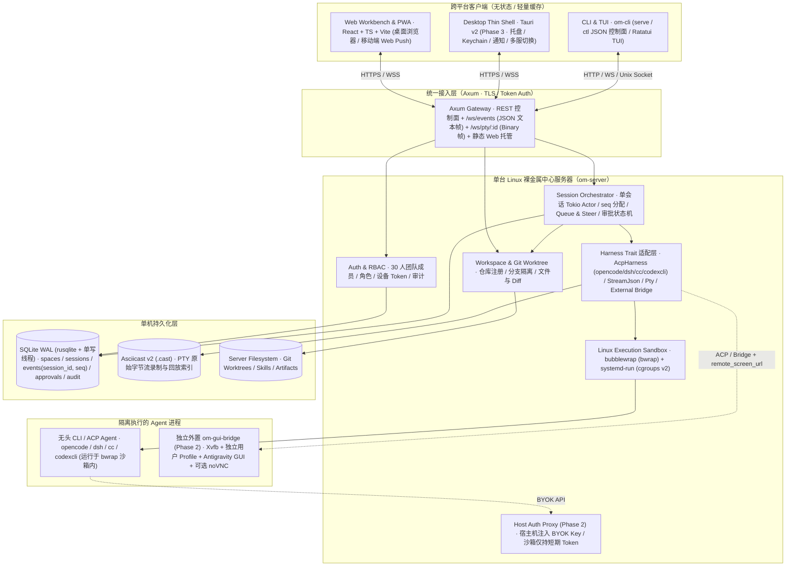
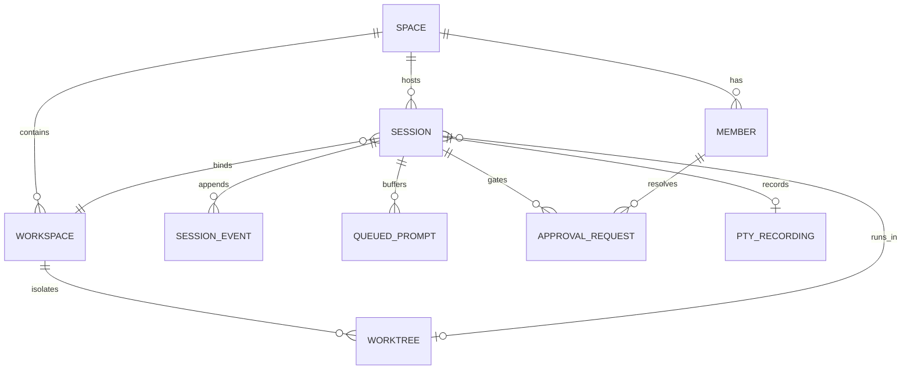

# OpenMirasim 系统架构设计

本文档定义 OpenMirasim 的总体架构、核心领域模型、通信协议、Agent 接入策略、Linux 裸金属沙箱安全边界以及 Monorepo 结构规划。已吸纳 [`design-review.md`](design-review.md) 中全部评审决议（R1–R7）。

---

## 1. 目标定位与设计约束

- **核心定位**：以**单台 Linux 裸金属服务器**为核心的团队协作式 C/S 架构跨平台 AI Agent 工作台（借鉴 Mirasim 的多 Agent 编排、断线续传与脚本化控制理念）。
- **团队规模**：面向 **30 人以内**团队自托管场景。
- **服务端平台**：**仅支持 Linux**（充分利用 `bubblewrap`、cgroups v2、POSIX PTY 与 Unix Domain Socket）。
- **架构原则**：
  1. **Single-Server-Centric**：所有会话、Worktree、Agent 进程、事件流与审计记录驻留中心服务器，客户端无状态且可随时通过 `last_seq` 追平恢复。
  2. **Vertical Slice First**：先以 Phase 0 跑通单 Agent + Web 闭环，再逐层叠加沙箱、团队协作、多端壳与生态扩展。
  3. **Rust Single Source of Truth**：Phase 0–2 采用 Axum REST + WebSocket，由 `om-core` 的 Rust 类型经 `ts-rs` 导出 TypeScript 契约，避免过早引入双传输栈。
  4. **Structured Agent Protocol First**：优先使用 **ACP（Agent Client Protocol）** 接入 Agent，次选各 CLI 的 `stream-json`，PTY 仅作原生终端视图与兜底；GUI 类 Agent（Antigravity GUI）通过独立外置桥接进程接入，不污染核心服务端。
  5. **Defense in Depth**：Git Worktree 负责代码隔离，Linux 沙箱（`bwrap` + cgroups v2）负责进程/文件/资源隔离，BYOK + 宿主机鉴权代理负责凭证安全。

---

## 2. 总体 C/S 拓扑



---

## 3. 核心领域模型



- **Space（团队空间）**：团队协作与权限边界（面向 <=30 人团队），挂载共享工作区、全局策略与成员列表。
- **Workspace & Worktree**：注册在 Linux 服务器上的代码仓库；并行会话各自运行在独立 Git Worktree 中避免代码冲突。
- **Session & Event Stream**：
  - 每个会话由独立 Tokio Actor 维护状态机（`Idle -> Running -> WaitingApproval -> Settled / Failed / Cancelled`）。
  - 结构化事件统一写入 SQLite `events(session_id, seq, ts, type, payload)`（复合主键 `(session_id, seq)`），由 Actor 在内存中单调递增 `seq` 并经单写线程落盘后广播。
  - 客户端重连只需提交 `last_seq`，服务端先顺序补发缺失区间，再无缝切换到实时 broadcast 流。
- **Approval Request（审批门控）**：当 Agent 请求执行越界写文件、高危命令或受限工具时，服务端挂起该调用并推送审批事件；成员在 Web / PWA 手机端 / CLI 审批后，通过原子状态转换防止重复审批并将结果回传给 Harness。
- **Queue & Steer**：成员可在运行中追加指令队列、插队或即时转向（Steer）；对不支持原生 Steer 的 Agent，由 Orchestrator 根据 `HarnessCapabilities` 自动降级为排队或取消重发。

---

## 4. 协议与传输设计（Phase 0–2）

- **单一传输栈**：仅使用 Axum 提供：
  - **REST API**：会话/空间/工作区 CRUD、历史事件分页、文件树与 Git Diff、审批提交、配置读写。
  - **`/ws/events`（JSON Text Frame）**：带标签的统一事件流（`#[serde(tag = "type")]`），携带 `session_id` 与单调 `seq`，便于抓包、调试和脚本消费。
  - **`/ws/pty/:session_id`（Binary Frame，Phase 3）**：独立的 PTY 终端字节流与窗口 Resize 控制通道，避免大输出刷屏阻塞聊天与审批事件。
- **单一类型事实源**：在 `crates/om-core` 中定义所有请求/响应与事件 Rust struct/enum，使用 **`ts-rs`** 自动导出 TypeScript 类型文件并在 CI 校验同步；`om-cli` 直接依赖 `om-core` 零开销复用。
- **远期扩展**：仅在 Phase 4+ 确有第三方多语言 SDK 需求时，再按需评估引入 Protobuf/gRPC。

---

## 5. Agent Harness 抽象与多 Agent 接入

### 5.1 统一 `Harness` Trait（位于 `om-core`）

```rust
#[derive(Debug, Clone, Serialize, Deserialize)]
pub struct HarnessCapabilities {
    pub native_approval: bool,
    pub steer: bool,
    pub resume: bool,
    pub structured_tools: bool,
    pub pty_attach: bool,
    pub remote_screen: bool,
}

#[async_trait]
pub trait Harness: Send + Sync {
    fn id(&self) -> &'static str;
    fn capabilities(&self) -> HarnessCapabilities;
    async fn start(&self, cfg: SessionConfig) -> Result<SessionHandle>;
    async fn send(&self, h: &SessionHandle, prompt: Prompt) -> Result<()>;
    async fn steer(&self, h: &SessionHandle, msg: Prompt) -> Result<()>;
    async fn respond_approval(&self, h: &SessionHandle, req_id: &str, decision: ApprovalDecision) -> Result<()>;
    async fn cancel(&self, h: &SessionHandle) -> Result<()>;
    async fn resume(&self, cfg: SessionConfig, native_session_id: &str) -> Result<SessionHandle>;
    fn events(&self, h: &SessionHandle) -> BoxStream<'static, HarnessEvent>;
}
```

### 5.2 分层接入优先级

1. **ACP（Agent Client Protocol，首选）**：
   - **`opencode`**（原生 `opencode acp`）— **Phase 0 首个接入标杆**。
   - **`dsh`**（DeepSeek Harness，原生 `dsh --profile acp` / 社区 `dsh-acp`）— Phase 1。
   - **`cc`**（Claude Code，通过 ACP 适配器接入；`--output-format stream-json` 作为备选）— Phase 1。
   - **`codexcli`**（OpenAI Codex CLI，通过 ACP 适配器或 `codex app-server` / `codex exec --json` 接入）— Phase 1。
2. **结构化 JSON 流（次选）**：对尚未完善 ACP 支持的 CLI 版本，通过 `StreamJsonHarness` 解析结构化事件。
3. **PTY（兜底与原生终端视图，Phase 3）**：基于 `portable-pty` 承载原生 TUI 交互与不支持结构化协议的工具，原始字节流走内存环形缓冲 + asciicast v2（`.cast`）文件。
4. **Antigravity GUI（独立外置桥接进程 `om-gui-bridge`，Phase 2）**：
   - 不将 Xvfb/GUI 依赖引入 `om-server` 主干，而是作为独立外部进程通过 ACP/桥接协议接入 `HarnessLayer`，并声明 `structured_tools: false`、`remote_screen: true`。
   - 运行约束：Linux `Xvfb` 虚拟显示 + **每成员独立 Linux 用户/Profile 隔离**（禁止共享单人登录态，不绕过登录校验/CAPTCHA）+ 按需拉起、空闲自动休眠与单机最大并发实例配额 + 前端提供“消息转发 + 一键切入 noVNC 画面接管”双视图。

---

## 6. Linux 裸金属安全与存储架构

### 6.1 执行沙箱与凭证安全
- **Phase 0（单人开发/本机验证）**：允许显式声明的 `Direct` 模式快速验证主干。
- **Phase 1（团队可用基线）**：基于 Linux 裸金属原生能力实现 **`bubblewrap` (`bwrap`) + `systemd-run`/cgroups v2** 沙箱：
  - 仅将当前会话对应的 Git Worktree 目录以可写方式 bind-mount 进沙箱，宿主机敏感路径不可见；
  - 通过 cgroups v2 限制单会话 CPU、内存与进程数（防止 fork bomb 或失控编译拖垮宿主机）；
  - 可配置网络命名空间与出口策略；
  - 审批联动：沙箱工作树内普通读写可按策略自动放行，越界操作/危险命令挂起触发 `ApprovalRequest`。
- **凭证合规与隔离（Phase 2 增强）**：
  - 团队默认采用 **BYOK**（个人或团队 API Key），开源项目不提供共享订阅反代能力。
  - 宿主机运行本地 HTTP 鉴权代理，沙箱内进程仅持有短期 `session_token` 与本地代理地址，真实上游 API Key 永不进入沙箱环境变量，也不得写入事件流与日志。

### 6.2 存储设计（`rusqlite` + `.cast`）
- **SQLite（WAL 模式）**：采用 **`rusqlite`** + 专用单写线程（通过 `mpsc` / `oneshot` 串行化写入，避免多线程写锁争用）+ 读连接池，无需独立数据库或独立 Event Log 服务。
- **核心表结构**：`spaces`、`members`、`workspaces`、`sessions`、`events(session_id, seq, ts, type, payload)`（复合主键 `(session_id, seq)`）、`approvals`、`pty_recordings`、`audit_logs`。
- **PTY 原始输出**：不进 SQLite，采用内存环形缓冲供在线客户端快速重连，同时追加写入按会话切分的 **asciicast v2（`.cast`）** 文件，SQLite 仅保存文件路径、大小与时间索引。

---

## 7. Monorepo 目录结构（先收敛，后按需拆分）

```text
openmirasim/
├── .agents/environment.json      # 云端开发环境入口（调用 setup-env.sh --cloud）
├── .cargo/config.toml            # 仓库级 Linux x86_64 lld 链接加速配置
├── .github/workflows/ci.yml      # 最小 CI（fmt / clippy / test / web typecheck）
├── rust-toolchain.toml           # 固定 Rust 工具链与组件
├── Cargo.toml                    # Rust Workspace（先收敛为 3 个核心 crate）
├── package.json                  # pnpm Workspace 根配置（固定 engines & packageManager）
├── pnpm-workspace.yaml
├── crates/
│   ├── om-core/                  # 领域模型、事件契约（ts-rs）、Harness/Sandbox Trait、错误与配置
│   ├── om-server/                # Linux 中心服务端（db / acp / orchestrator / sandbox / api / harness）
│   └── om-cli/                   # CLI（serve / ctl JSON 控制面）与 Phase 3 Ratatui TUI
├── apps/
│   ├── web/                      # 共享 React + TypeScript + Vite 前端工作台（含 Phase 2 PWA）
│   └── tauri/                    # Phase 3 引入：Tauri v2 桌面薄壳
├── scripts/
│   └── setup-env.sh              # 幂等环境初始化脚本（支持 --cloud / --desktop / --android）
├── tests/
│   └── e2e/                      # Playwright 与端到端集成测试
└── docs/
    ├── architecture.md           # 本文档
    ├── tech-stack.md             # 技术栈与构建环境规范
    ├── design-review.md          # 架构评审与决议记录
    └── roadmap.md                # 分阶段 Demo 验收清单与双 Agent 协作分工
```

> 当 `om-server` 内模块体量增长并形成稳定边界后，再按需拆分出独立 crate（如 `om-storage`、`om-runtime`）及独立外置桥接进程（如 `om-gui-bridge`）。
